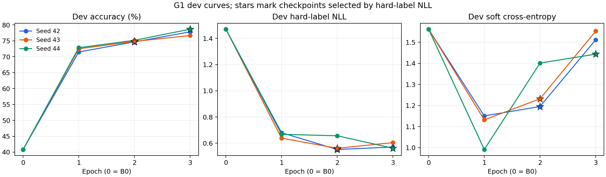

# G1 结果：Backbone LoRA + 原 LM Head

**状态：三个 seed 的训练、dev 选模和官方 test 已全部完成，产物复核通过。**

在相同模型起点、输入、硬标签和数据划分下，G1 的 test Accuracy 从 B0 的 **46.30%** 提升到 **76.63% ± 1.57 个百分点**，平均提升 **30.33 个百分点**。这里的 ± 是三个 seed 的样本标准差，不是置信区间。

本结果衡量与数据集教师标签的一致性。它支持“固定 LM Head 时，Backbone LoRA 专项监督有效”，还不能回答 Full FT 或专用 Decision Head 是否更好。

## 1. B0 与 G1 总体对照

G1 列为 seed 42／43／44 各自选中 checkpoint 的 test 指标均值与样本标准差，未挑选 test 最佳 seed，也不是三模型集成。所有概率均未做温度校准。

| 指标 | B0 | G1（三 seed） |
| --- | --- | --- |
| Accuracy | 46.30% | **76.63% ± 1.57 pp** |
| Hard NLL | 1.3324 | **0.5766 ± 0.0161** |
| Soft CE | 1.5062 | 1.3339 ± 0.1422 |
| KL(gold ‖ prediction) | 0.7389 | 0.5665 ± 0.1422 |
| Soft Brier | 0.3520 | 0.1607 ± 0.0239 |
| Hard Brier | 0.7224 | 0.3300 ± 0.0062 |
| ECE15 | 0.2017 | **0.0712 ± 0.0229** |
| Score 期望值 MAE | 0.7047 | 0.3181 ± 0.0139 |

`pp` 表示百分点。Accuracy 平均提升的配对 case bootstrap 95% 区间为 **+27.52～+33.40 个百分点**（400 cases，2,000 次重采样）。它是在这三个已训练模型固定后，对测试 case 的不确定性估计，不包含重新训练更多 seed 的全部不确定性。

## 2. 各 seed 的选模与结果

每个 seed 都完成了 3 epochs／450 个优化步。选模只看 dev Hard NLL，包含 step 0，同分选更早 checkpoint；全部选择锁定后才运行 test。

| Seed | 选中 epoch／step | 选中 dev NLL | Test 正确数 | Test Accuracy | Test NLL | Test ECE15 |
| --- | --- | --- | --- | --- | --- | --- |
| 42 | 2／300 | 0.5519 | 1,515／2,000 | 75.75% | 0.5592 | 0.0551 |
| 43 | 2／300 | 0.5613 | 1,514／2,000 | 75.70% | 0.5797 | 0.0612 |
| 44 | 3／450 | 0.5617 | 1,569／2,000 | 78.45% | 0.5910 | 0.0974 |

Seed 44 的 Accuracy 最高，但 Hard NLL、Soft CE 和 ECE 都比另外两个 seed 差。其 test Soft CE 为 1.4961，seed 42／43 为 1.2307／1.2748，说明选对更多题不等于完整概率分布更好。主结论使用三 seed 统计量。

## 3. 分工作流与题型

以下 G1 为三 seed Accuracy 的均值 ± 样本标准差，提升为均值减 B0。每个工作流每 seed 有 500 道题。

| 工作流 | B0 | G1 | 平均提升 |
| --- | --- | --- | --- |
| Agent 轨迹观测 | 34.40% | 70.80% ± 1.60 pp | +36.40 pp |
| 客服 | 61.80% | 80.13% ± 0.81 pp | +18.33 pp |
| 发票处理 | 30.60% | 80.67% ± 2.95 pp | +50.07 pp |
| 安全事件 | 58.40% | 74.93% ± 1.29 pp | +16.53 pp |

| 类型 | 每 seed 题数 | B0 | G1 | 平均提升 |
| --- | --- | --- | --- | --- |
| Choice | 600 | 57.00% | 73.39% ± 0.82 pp | +16.39 pp |
| Noul | 600 | 49.33% | 83.89% ± 0.96 pp | +34.56 pp |
| Score | 800 | 36.00% | 73.63% ± 2.60 pp | +37.63 pp |

所有工作流和题型的平均 Accuracy 均提升；这些是描述性分组结果，没有逐组显著性或多重检验结论。

提升也伴随着部分原本正确的题变错：seed 42／43／44 分别修正了 B0 的 763／769／797 个错误，同时新增了 174／181／154 个与 gold 不一致的选择。不能把总体提升理解为逐题都改善。

## 4. 训练曲线与选模原因



星号表示按 dev Hard NLL 选中的 checkpoint，epoch 0 是 B0。可下载 [SVG](figures/g1_dev_curves.svg)。

- Seed 42／43 在第 3 个 epoch 的 dev Accuracy 继续上升，但 Hard NLL 变差，因此选择第 2 个 epoch。
- 三个 seed 的 dev Soft CE 均在第 1 个 epoch 后回升，虽然 Accuracy 仍在增加。这反映硬标签分类目标与完整软分布拟合目标的差异，后续软标签实验应单独比较。
- 本轮遵守预先固定的 Hard NLL 选模规则，没有根据 test 分数改选 checkpoint，也没有事后改用 Soft CE 选模。

## 5. 计算成本

| 项目 | B0 | G1 |
| --- | --- | --- |
| 每 case p50 延迟 | 330.91 ms | 1,140.28 ± 5.03 ms |
| 每 case p95 延迟 | 366.84 ms | 三 seed 平均 1,241.33 ms |
| 评估峰值 allocated | 1.73 GiB | 各 seed 约 1.78 GiB |
| 训练峰值 allocated | 不训练 | 15.19～15.24 GiB |

G1 p50 一栏是三个 run 各自 p50 的均值 ± 样本标准差。延迟单位是一个 case 的五道独立问题，包括分词、传输、同步推理和概率搬回 CPU。两者均使用同一 GPU 型号和原生评估后端。

**当前未合并 LoRA 的实现，p50 约为 B0 的 3.45 倍。** 这是本次运行栈的观测值，不是 LoRA 的固有倍率，也不代表合并后的部署速度。后续比较不同 Head 的成本时，需要统一适配器合并状态和推理实现。

正式流程从 **2026-10-21 21:59:59 到 2026-10-22 01:30:29（北京时间）**，总耗时约 **3 小时 30 分 30 秒**，包含三 seed 训练、checkpoint 写入、dev 与 test 评估。

## 6. 固定配置与边界

| 项目 | 设置 |
| --- | --- |
| B0 对照 | `eval_20261021_170132_311730_seed42` |
| G1 Run ID | `train_20261021_215958_618296` |
| 模型起点 | `/data/data_cold/Workshop/wangyueyi/llm_modelscope/qwen3.5-0.8b`，与 B0 相同 |
| 数据版本 | `d9eda7f31ba227333213a1787f2c78fdaa4090c8` |
| 数据划分 | train 960 cases／4,800 题；dev 120／600；calibration 120；test 400／2,000 |
| LoRA | rank 16，alpha 32，dropout 0，186 个注意力／DeltaNet／MLP 线性投影 |
| 参数 | 10,822,656 个 FP32 适配器参数可训练；752,393,024 个原始参数冻结 |
| 冻结部分 | 原 LM Head、绑定的 embedding、原始 Backbone 及其余参数 |
| 损失 | 仅有效候选字母上的硬标签 CE，标签取稳定身份规则下的 gold argmax |
| 优化 | AdamW，LR 2e-4，weight decay 0.01，clip 1.0，23 步 warmup 后 cosine |
| 训练量 | seed 42／43／44，各 3 epochs／450 步；microbatch 8 × 累积 4，有效 batch 32 |
| 训练后端 | 项目内 FLA 0.5.2，仅切换 DeltaNet chunk 运算；归一化和卷积保持 native |
| 评估后端 | 与 B0 一致的 native 路径，BF16，FP32 候选 softmax，LoRA 未合并 |

完整配置：[g1.yaml](../experiments/02_supervised/configs/g1.yaml)。没有使用 soft gold 损失、Brier 辅助损失、label smoothing、候选重排增强或温度拟合；calibration 未参与推理或训练。

训练样本预检确认零适配器 logits 与 B0 相同、梯度有限、冻结权重不变、adapter 重载预测一致。FLA／native 的 BF16 梯度与输出是数值近似而非逐位相等，差异记录在 [训练内核预检](../outputs/02_supervised/g1/kernel_profile_train.json)；所有选模和正式评估均恢复 native。

本轮只回答固定 LM Head 下 B0→G1 的对照，尚无 G2、P0、P1、P2、C1 或跨工作流／未知候选泛化结论。公共教师标签的一致性也不能替代真实业务正确率。

## 7. 复核与可复用产物

复核确认：

- 三个 seed 各 450 个优化步、14,400 次训练题呈现，loss 和梯度范数均有限，全部原始参数的训练前后哈希一致。
- 选中的 epoch 为 2／2／3，确为各自 dev Hard NLL 最低点；三个选择先锁定，再开始 test。
- 每 seed test 完整覆盖 400 cases／2,000 题，无校准集推理。
- 共核对 13,200 条保存预测，包含 1,800 条复用的 B0 dev 记录；case／问题／候选／gold 与固定原始数据一一对应。
- NPZ 与 JSONL 身份、mask、logits 一致；由 logits 重建概率的最大绝对差小于 `1.7e-7`。总体／分组指标、三 seed 均值和样本标准差、配对 bootstrap 均复算一致。
- 模型、代码快照、数据、划分与本地 FLA 文件哈希复核通过，所选适配器 SHA256 和训练样本重载检查通过。

该结论已通过独立 CPU 产物审查。训练启动前的 52 项测试通过；本次收尾以保存产物离线复算，未重复模型推理或训练。

关键文件：

- [正式运行目录](../outputs/02_supervised/g1/train_20261021_215958_618296/)
- [总体汇总与配对区间](../outputs/02_supervised/g1/train_20261021_215958_618296/summary.json)
- [分组、误差变化与曲线数据](../outputs/02_supervised/g1/train_20261021_215958_618296/analysis.json)
- [完整复核记录](../outputs/02_supervised/g1/train_20261021_215958_618296/verification.json)
- [锁定的选模清单](../outputs/02_supervised/g1/train_20261021_215958_618296/selections.json)
- [三个可复用适配器的路径与哈希](../outputs/02_supervised/g1/train_20261021_215958_618296/selected_adapters.json)
- [训练与评估日志](../outputs/02_supervised/g1/train_20261021_215958_618296/run.log)

适配器保存在对应 seed 的 `checkpoints/step000300` 或 `step000450`，需配合原始模型加载；未复制或改写原始模型。加载示例使用固定的首个 seed 42，主结果仍是三 seed 统计量，不按 test 最高分择优。

```python
from pathlib import Path
import yaml
from peft import PeftModel
from jev.models.lm_readout import load_local_model
from jev.training.kernels import set_delta_backend

run = Path("outputs/02_supervised/g1/train_20261021_215958_618296")
model_config = yaml.safe_load((run / "config.yaml").read_text())["model"]
model, tokenizer, _ = load_local_model(model_config)
adapter_path = run / "seed42/checkpoints/step000300"
model = PeftModel.from_pretrained(model, str(adapter_path), is_trainable=False)
set_delta_backend(model, "native")
model.eval()
```

代码使用项目 `src` 模块，需从仓库根目录设置 `PYTHONPATH=src`。具体实验运行方式见 [阶段 2 说明](../experiments/02_supervised/README.md)；已完成的 run 无需使用 `--resume`。
