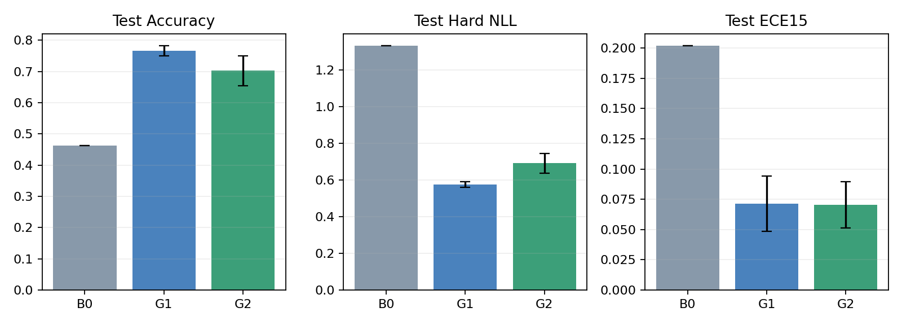
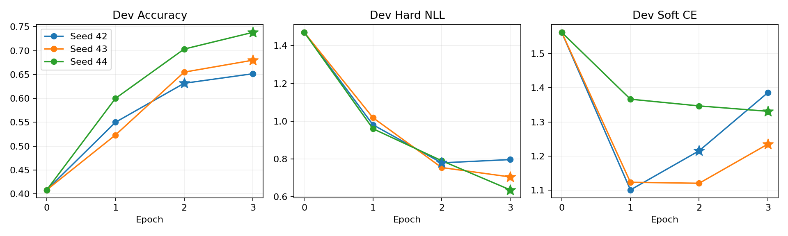

# G2 结果：文本模型全量微调 + 原 LM Head

**状态：三个 seed 的 450 步训练、dev 选模及官方 test 已完成，离线产物复核通过。**

G2 的 test Accuracy 为 **70.25% ± 4.74 pp**。本实验保留 B0／G1 的候选字母读出、输入和划分，训练全部 **752,393,024** 个文本参数（包括绑定的 embedding／LM Head）。

Accuracy 衡量与数据集教师 gold argmax 的一致性，不能替代人工业务真值。± 表示三个 seed 的样本标准差，结果没有进行温度校准。

就当前两套固定训练配方而言，**G1 的 Accuracy 更高、Hard NLL 更低，seed 波动也更小**。G2 仍比 B0 提升 23.95 个百分点，但未超过 G1；结论限定于本次数据、学习率和训练精度。

概率指标有不同侧重：G2 的 Soft CE／KL 均值略低，ECE15 与 G1 接近，而 Brier 和 Score MAE 更差，不能用单个指标概括全部概率质量。

## 总体结果

| 指标 | B0 | G1（三 seed） | G2（三 seed） |
| --- | --- | --- | --- |
| Accuracy | 46.30% | 76.63% ± 1.57 pp | 70.25% ± 4.74 pp |
| Hard NLL | 1.3324 | 0.5766 ± 0.0161 | 0.6928 ± 0.0539 |
| Soft CE | 1.5062 | 1.3339 ± 0.1422 | 1.2844 ± 0.0589 |
| KL(gold ‖ prediction) | 0.7389 | 0.5665 ± 0.1422 | 0.5170 ± 0.0589 |
| Soft Brier | 0.3520 | 0.1607 ± 0.0239 | 0.1788 ± 0.0076 |
| Hard Brier | 0.7224 | 0.3300 ± 0.0062 | 0.4050 ± 0.0406 |
| ECE15 | 0.2017 | 0.0712 ± 0.0229 | 0.0704 ± 0.0192 |
| Score 期望 MAE | 0.7047 | 0.3181 ± 0.0139 | 0.3703 ± 0.0719 |

相对 B0 的平均 Accuracy 差为 **+23.95 pp**，配对 case bootstrap 95% 区间为 **+21.42～+26.62 pp**。

相对 G1 的平均 Accuracy 差为 **-6.38 pp**，配对 case bootstrap 95% 区间为 **-7.63～-5.15 pp**。

这里按每个已训练模型的正确性取 seed 均值，再对完整 case 重采样；没有平均概率构造集成模型。置信区间反映固定模型下测试 case 的不确定性，三 seed 标准差反映本次重新训练的波动，两者含义不同。



误差棒为 seed 样本标准差；B0 为单个固定模型。[SVG](figures/g2_comparison.svg)。

## 选模与各 seed 结果

每个 seed 完成 3 epochs／450 步。只按 dev Hard NLL 最小值选模，同分取更早步骤，包含 step 0。三个选择锁定后才开始 test。

| Seed | 选中 epoch／step | Dev NLL | Test Accuracy | Test NLL | Test ECE15 |
| --- | --- | --- | --- | --- | --- |
| 42 | 2／300 | 0.7794 | 65.20% | 0.7442 | 0.0543 |
| 43 | 3／450 | 0.7047 | 70.95% | 0.6973 | 0.0654 |
| 44 | 3／450 | 0.6361 | 74.60% | 0.6368 | 0.0916 |



星号为 dev NLL 选择点，epoch 0 复用经训练样本原生读出一致性验证的 B0 dev。[SVG](figures/g2_dev_curves.svg)。Hard NLL、Accuracy 与 Soft CE 衡量不同目标；没有根据 test 改选 checkpoint。

## 分工作流与题型

| 工作流 | B0 Accuracy | G1 Accuracy | G2 Accuracy | G2 − G1 |
| --- | --- | --- | --- | --- |
| Agent 轨迹观测 | 34.40% | 70.80% | 67.07% ± 3.90 pp | -3.73 pp |
| 客服 | 61.80% | 80.13% | 73.73% ± 4.20 pp | -6.40 pp |
| 发票处理 | 30.60% | 80.67% | 68.53% ± 11.18 pp | -12.13 pp |
| 安全事件 | 58.40% | 74.93% | 71.67% ± 1.80 pp | -3.27 pp |

| 类型 | B0 Accuracy | G1 Accuracy | G2 Accuracy | G2 − G1 |
| --- | --- | --- | --- | --- |
| Choice | 57.00% | 73.39% | 67.89% ± 2.93 pp | -5.50 pp |
| Noul | 49.33% | 83.89% | 77.22% ± 4.07 pp | -6.67 pp |
| Score | 36.00% | 73.62% | 66.79% ± 6.84 pp | -6.83 pp |

上述分组为描述性比较，未做逐组多重检验。完整逐问题指标见 analysis.json。

| Seed | 修正 B0 错误／新增错误 | 修正同 seed G1 错误／新增错误 |
| --- | --- | --- |
| 42 | 628／250 | 122／333 |
| 43 | 699／206 | 82／177 |
| 44 | 751／185 | 57／134 |

## 训练设置、成本与限制

| 项目 | B0 | G1 | G2 |
| --- | --- | --- | --- |
| 每 case p50 | 330.91 ms | 1140.28 ms | 328.49 ms |

- 原始模型：`/data/data_cold/Workshop/wangyueyi/llm_modelscope/qwen3.5-0.8b`；数据版本：`d9eda7f31ba227333213a1787f2c78fdaa4090c8`。
- train／dev／calibration／test 分别为 960／120／120／400 cases；训练只用 gold argmax 硬候选 CE，校准集未使用。
- 三 seed 从相同原始模型独立初始化，不继承 G1 adapter。全量 FP32 参数、梯度和 Adam 状态，BF16 autocast；AdamW LR 2e-5、weight decay 0.01、clip 1.0、23 步 warmup 后 cosine。
- 有效 batch 32 = microbatch 4 × 累积 8。每 seed 14,400 次训练题呈现。训练只切换 FLA DeltaNet chunk；评估为独立 BF16 副本、原生内核，保留原生 FP32 rotary buffers，不损伤 FP32 训练权重。
- G2 每 case p50：328.49 ± 1.64 ms；p95 均值：383.50 ms。各 seed 训练峰值 allocated：21.26～21.38 GiB；评估峰值：1.73～1.73 GiB。
- 延迟是每 case 五道独立问题，包含分词、传输、同步原生推理和概率搬回 CPU，排除模型加载、预热和文件写入；p50 是各 seed p50 的均值。G1 当前未合并 adapter，其运行栈开销不能当作 LoRA 的固有倍率。
- 流程开始：2026-10-22T10:48:11.862147+08:00；完成：2026-10-22T15:21:14.677302+08:00。墙钟跨度包含 checkpoint IO、dev／test、故障和暂停；各 seed 纯更新耗时保存在 analysis.json，不含评估和保存。
- G1 使用 LR 2e-4，冻结 BF16 原参数并训练 FP32 LoRA；G2 使用 LR 2e-5，全部原参数为 FP32 master。本结果比较两套固定配方，不代表两种方法分别充分调参后的最优结果。

本轮围绕 Q1 的固定 LM Head 比较，尚不能回答专用 Pointer／Candidate Head 的价值、未知候选泛化或软标签蒸馏收益。

## 中断与恢复记录

原运行在 seed 42 第 154 步因 CUDA OOM 中断，step 150 的完整 FP32 模型／Adam／scheduler／RNG 检查点保留，第 1 轮 dev 也已完成。

恢复前仅用训练集补测：完整 32 题梯度累积更新、原故障批次、最长输入与三次独立原生评估切换。通过后使用 `PYTORCH_CUDA_ALLOC_CONF=expandable_segments:True` 恢复内存分配；原训练源码、配置、microbatch 和选模协议不变。

从 step 150 恢复，旧的未提交 151～153 步另存档后重放，最终 train.jsonl 仍为连续 450 个已提交步骤。旧故障元数据、预检脚本／结果和启动记录保存在运行目录的 recovery/allocator_20261022，未把部分 dev 当作正式 test 结论。

## 复核和复用

离线复核 13,200 条 G2 保存预测（其中 1,800 条复用 B0 dev），另核对 B0／G1 的 8,000 条 test 预测；没有重新进行模型推理。身份、候选、gold、hard target、原始 logits／mask 和概率与固定原始数据一一对应。重建概率最大绝对差为 1.82e-07。

总体／分组／bootstrap 指标、三 seed 统计与配对比较均复算一致；源代码、配置、模型、原始数据、划分、FLA 和内核预检哈希核对通过；所选完整 checkpoint 包括 trainer.pt 在内的所有文件校验通过。文件 mtime 支持先锁定全部选择再开始 test 的顺序，这属于文件系统证据，不是外部防篡改时间戳。

- [正式汇总](../outputs/02_supervised/g2/train_20261022_104739_026131/summary.json)
- [分组、曲线与成本](../outputs/02_supervised/g2/train_20261022_104739_026131/analysis.json)
- [复核记录](../outputs/02_supervised/g2/train_20261022_104739_026131/verification.json)
- [所选完整模型与 SHA256](../outputs/02_supervised/g2/train_20261022_104739_026131/selected_models.json)
- [训练日志](../outputs/02_supervised/g2/train_20261022_104739_026131/run.log)

完整权重使用独立文本模型的 canonical 参数名，不能直接按原多模态 checkpoint 名称加载。复用时使用 `experiments/02_supervised/run_g2.py` 中的 `selected_eval_model`，以保留绑定权重和原生 BF16／FP32 buffer 策略。完成的 run 不需要再调用 --resume。

可用以下 CPU 命令重复复核并更新报告；不会进行模型推理：

```bash
python experiments/02_supervised/finish_g2.py --run outputs/02_supervised/g2/train_20261022_104739_026131 --update-docs
```
