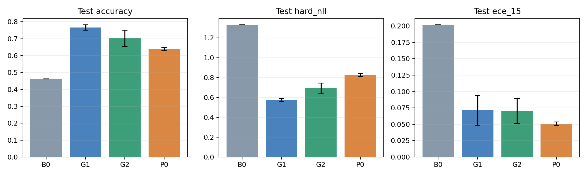
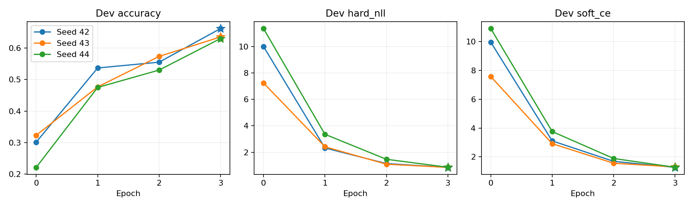
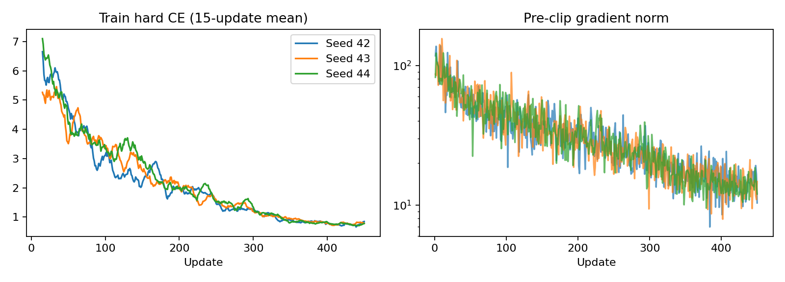
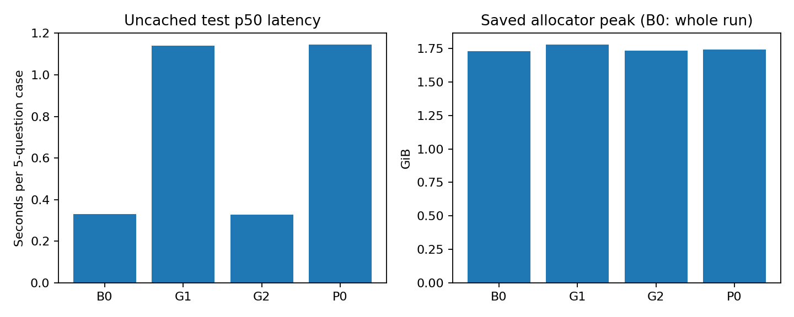

# P0：冻结 Backbone + Pointer Head

**状态：三个 seed 的 450 步训练、dev 选模及官方 test 已完成，离线结果复核通过。**

P0 的 test Accuracy 为 **63.80% ± 0.90 pp**。冻结原始模型，只训练 262,144 个 Pointer 参数，就比 B0 提高了 **17.50 个百分点**；当前固定配方下，Accuracy 仍低于 G1 的 76.63% 和 G2 的 70.25%。

Accuracy 衡量与教师生成的 gold argmax 的一致性。± 为三个独立训练 seed 的样本标准差，结果未经温度校准。以下结果来自保存的预测，不重新推理或根据 test 改选模型。

P0 回答：冻结原始 Qwen3.5 的表示，只训练一个小型决策 Head，能学到多少决策能力？结果属于当前 Head 与训练配方，不能单独证明预训练模型是否具有全部相关语义能力。

## 总体结果

| 指标 | B0 | G1（三 seed） | G2（三 seed） | P0（三 seed） |
| --- | --- | --- | --- | --- |
| Accuracy | 46.30% | 76.63% ± 1.57 pp | 70.25% ± 4.74 pp | **63.80% ± 0.90 pp** |
| Hard NLL | 1.3324 | 0.5766 | 0.6928 | 0.8284 ± 0.0148 |
| Soft CE | 1.5062 | 1.3339 | 1.2844 | 1.2569 ± 0.0141 |
| KL(gold ‖ prediction) | 0.7389 | 0.5665 | 0.5170 | 0.4896 ± 0.0141 |
| Soft Brier | 0.3520 | 0.1607 | 0.1788 | 0.1688 ± 0.0019 |
| Hard Brier | 0.7224 | 0.3300 | 0.4050 | 0.4796 ± 0.0084 |
| ECE15 | 0.2017 | 0.0712 | 0.0704 | 0.0509 ± 0.0027 |
| Score 期望 MAE | 0.7047 | 0.3181 | 0.3703 | 0.4284 ± 0.0098 |

P0 的 Soft CE／KL 和 ECE 均值低于 G1／G2，但 Hard NLL 和 Accuracy 更差；Soft Brier 介于两者之间。各指标衡量不同目标，较低的 ECE 不等于更准确，也不能证明所有分组都校准良好。



误差棒为三 seed 样本标准差，B0 为单个固定模型。[SVG](figures/p0_comparison.svg)。

| Accuracy 比较 | 平均差 | 配对 case bootstrap 95% 区间 |
| --- | --- | --- |
| P0 − B0 | +17.50 pp | +14.80～+20.35 pp |
| P0 − G1 | -12.83 pp | -14.78～-10.93 pp |
| P0 − G2 | -6.45 pp | -8.25～-4.63 pp |

按各已训练模型的正确性取 seed 均值，再对完整 case 重采样 2,000 次；没有平均概率构造集成模型。区间反映固定模型下测试案例的不确定性，三 seed 标准差反映重新训练的波动。

## 选模与学习过程

每个 seed 独立实测随机 Head 的 epoch0，再比较 epochs1～3，只按 dev Hard NLL 最小值选模，同分选更早步骤。三个选择全部锁定后才开始 test。

| Seed | 选中 epoch／step | Dev NLL | Test Accuracy | Test NLL | Test ECE15 |
| --- | --- | --- | --- | --- | --- |
| 42 | 3／450 | 0.8532 | 64.75% | 0.8214 | 0.0477 |
| 43 | 3／450 | 0.8556 | 62.95% | 0.8184 | 0.0521 |
| 44 | 3／450 | 0.8619 | 63.70% | 0.8454 | 0.0528 |

| Seed | 随机 Head dev NLL | Epoch1 | Epoch2 | Epoch3 |
| --- | --- | --- | --- | --- |
| 42 | 10.0103 | 2.3244 | 1.1405 | 0.8532 |
| 43 | 7.2488 | 2.4141 | 1.0930 | 0.8556 |
| 44 | 11.3680 | 3.3589 | 1.4673 | 0.8619 |

随机投影最初给出很差的概率，不能复用 B0 指标当作 epoch0。三个 seed 的 dev NLL 都持续下降至训练末轮，因此本轮没有看到 dev NLL 回升的过拟合迹象；也没有证据证明 3 轮已经收敛。若研究更长训练或初始化／归一化，应另建 dev 驱动的实验，不改写本轮结果。



星号表示按 dev NLL 选中的 epoch。[SVG](figures/p0_dev_curves.svg)。



左图为在线训练 CE 的 15 步滑动均值，右图为裁剪前梯度范数；不能将在线训练均值直接当作固定模型的 train NLL。[SVG](figures/p0_training_curves.svg)。

## 分工作流与题型

| 工作流 | B0 Accuracy | G1 Accuracy | G2 Accuracy | P0 Accuracy |
| --- | --- | --- | --- | --- |
| Agent 轨迹观测 | 34.40% | 70.80% | 67.07% | 51.40% ± 1.60 pp |
| 客服 | 61.80% | 80.13% | 73.73% | 72.00% ± 0.72 pp |
| 发票处理 | 30.60% | 80.67% | 68.53% | 66.27% ± 2.25 pp |
| 安全事件 | 58.40% | 74.93% | 71.67% | 65.53% ± 0.81 pp |

| 类型 | B0 Accuracy | G1 Accuracy | G2 Accuracy | P0 Accuracy |
| --- | --- | --- | --- | --- |
| Choice | 57.00% | 73.39% | 67.89% | 64.22% ± 1.11 pp |
| Noul | 49.33% | 83.89% | 77.22% | 73.67% ± 1.74 pp |
| Score | 36.00% | 73.62% | 66.79% | 56.08% ± 0.71 pp |

P0 在四个工作流上都高于 B0。相对 G1，差距在 Agent 轨迹观测及 Score 题上尤其明显；这些是描述性分组结果，没有逐组多重检验。

## 成本与结论边界

| 项目 | B0 | G1 | G2 | P0 |
| --- | --- | --- | --- | --- |
| 可训练参数 | 0 | 10,822,656 | 752,393,024 | 262,144 |
| 每 case p50 | 330.91 ms | 1,140.28 ms | 328.49 ms | 1,144.31 ms |
| 评估峰值 allocated | 1.73 GiB | 1.78 GiB | 1.73 GiB | 1.74 GiB |

P0 新 Head 的参数量约为原始文本模型的 0.035%。每 seed 的纯更新累计约 5.15～5.92 秒，但这不包含一次性的 train／dev 特征提取、保存、验证及完整测试。整个流程从 2026-10-22 23:29:01 至 2026-10-23 00:16:37（北京时间），共约 **47 分 36 秒**；不能用缓存后的 Head 更新耗时代表全流程成本。

P0 p50 为三个 run 各自 p50 的均值，跨 seed 标准差 73.04 ms；p95 均值 1,297.42 ms。延迟按每 case 五条独立输入统计，包含分词、候选定位、传输、原生 Backbone、特征搬运、FP32 Head 和概率转换，排除加载、预热、文件写入与指标计算。正式 test 没有使用特征缓存。

当前实现绕过 LM 词表投影，但未带来端到端加速。原 LM Head 与输入 embedding 绑定，冻结后仍保留；P0 使用原生 `no_grad` 表示提取及特征搬运，G1 使用未合并 adapter，几组的运行路径存在差异，不能把当前延迟归因于 Head 结构本身。



每个柱为 run 统计的均值，不包含特征缓存推理。B0 显存来自原报告保留的整轮评估峰值，G1／G2／P0 为各 test 的峰值；未为对齐口径而重测 B0。[SVG](figures/p0_costs.svg)。

- **已支持的结论：** 冻结的原始表示配合受监督 Pointer 读出，能明显提高本数据集上的教师硬标签一致率。
- **尚不能回答：** B0 与 P0 同时改变了监督训练和读出结构，不能单独归因于 Pointer；P0 与 G1／G2 同时改变 Head 与 Backbone 适配，也不能据此认定某类 Head 更优。
- **后续对照：** P0→P1→P2 在 Pointer 结构固定时研究 Backbone 适配；G1 与 P1 等匹配适配方式的对照再回答 Q2。当前没有候选重排、动态数量留出或未知语义候选实验，不能宣称相应泛化能力。

## 实现与固定设置

完整输入、聊天模板、候选字母／身份和数据划分沿用 B0／G1／G2。使用助手回答前的最后有效 token 作为决策表示，候选文本末尾非空字符所在 token 作为候选表示。通过完整候选区块及 tokenizer offsets 定位，处理重复文字、Unicode 和左侧 padding。

| 项目 | 设置 |
| --- | --- |
| 初始化 | 原始 Qwen3.5-0.8B；不使用 G1／G2 微调权重 |
| 冻结 | 全部 752,393,024 个原始文本参数，包括绑定的 embedding／原 LM Head |
| 特征 | 原生 BF16 Backbone，保留原生 FP32 rotary buffers；绕过 LM 词表投影 |
| Pointer Head | 两个无 bias 的 1024→128 共享投影，匹配后只在有效候选范围内归一化 |
| 可训练参数 | 262,144 个 FP32 参数，约 1 MiB 权重 |
| 数据 | train 960 cases／4,800 题；dev 120／600；test 400／2,000；calibration 120 预留 |
| 监督 | gold argmax 硬标签候选交叉熵；soft gold 只用于评估 |
| 训练 | seed 42／43／44，各 3 epochs／450 步，有效 batch 32 |
| 优化 | AdamW，LR 1e-3，weight decay 0.01，clip 1.0；23 步 warmup 后 cosine |
| 特征缓存 | 仅 train／dev；固定每 case 五条独立输入、相同原生后端和精度，缓存转存为无损 FP32 数值 |
| 选模 | 每个 seed 实测随机 Head 的 epoch0，再比较 epochs1～3，按 dev Hard NLL 最小选模，同分取更早步骤 |
| 正式 test | 三个选择全部锁定后，每 seed 一次完整、未缓存的 Backbone＋Head 前向 |
| 硬件 | 物理 GPU0（5090 D v2）；GPU1 被其他任务占用，未干预其任务 |

Pointer Head 的随机 epoch0 不等于 B0，不能复用原 LM Head 的 dev 指标。评估延迟包含分词、位置映射、传输、Backbone、Head 和概率转换，不能将缓存后的 Head 耗时当作完整推理耗时。

Head 对候选共享参数并支持数量变化，但顺序拼接的因果 Backbone 仍可能产生位置偏好。本轮不宣称候选顺序不变或未知候选语义泛化。

## 启动前验证

- 93 项 CPU 测试通过；代码冻结后 17 项 Pointer／流程测试再次通过；独立规格和质量审查通过。
- 真实 tokenizer 与 GPU 原生模型预检通过：候选位置覆盖正确，隐藏表示与原始模型参考路径逐位一致，Pointer 路径未调用 LM Head。
- Backbone 全部参数、缓冲区、精度及原 embedding／LM Head 权重绑定未改变；新的 Head 两路投影均有有限梯度并发生实际更新。
- 固定训练 case 上，缓存特征与完整前向的 Head scores 逐位一致；最大训练输入 666 tokens。
- GPU smoke 仅使用 8 个 train cases：两次更新后保存并重载 Head／Adam／scheduler／RNG，再完成第三次更新，未访问 dev／test。

预检对小批量的重复拟合只用于检查梯度与路径连通性，不作为正式效果证据。源码、原始模型、数据、划分、特征缓存及 Head 检查点均保留哈希；恢复会验证历史证据，部分 heldout 产物会拒绝隐式重跑。

## 入口与运行记录

- [配置](../experiments/02_supervised/configs/p0.yaml)
- [运行入口](../experiments/02_supervised/run_p0.py)
- [实现计划](../docs/superpowers/plans/2026-10-22-p0.md)
- [GPU 训练样本预检](../outputs/02_supervised/p0/preflight_train.json)
- [启动记录](../outputs/02_supervised/p0/launches/20261022_232836.json)
- [启动日志](../outputs/02_supervised/p0/launches/20261022_232836.log)
- [启动核验](../outputs/02_supervised/p0/train_20261022_232846_262432/startup_verification.json)：保留启动当时的检查记录，当时只验证了后台进程与特征提取，smoke 更新不算正式实验结果；完成状态以最终结果复核为准。

正式运行目录：[train_20261022_232846_262432](../outputs/02_supervised/p0/train_20261022_232846_262432/)。[状态](../outputs/02_supervised/p0/train_20261022_232846_262432/metadata.json)为 `complete`，[原始汇总](../outputs/02_supervised/p0/train_20261022_232846_262432/summary.json)已包含三 seed 均值、样本标准差以及相对 B0／G1／G2 的配对比较，[训练日志](../outputs/02_supervised/p0/train_20261022_232846_262432/run.log)保留完整过程。P1／P2／C1 及蒸馏、校准尚未启动。

## 结果复核与复用

离线复核范围为 **13,200 条 P0 预测**（三个 seed，各 4×600 条 dev 和 2,000 条 test），另核对 B0／G1／G2 的 **14,000 条参考 test 预测**。检查身份、候选、gold／hard target、原始 logits、mask、归一化概率，以及总体／分组／bootstrap 指标、seed 汇总和配对差值。全程只读取保存产物，不重新执行模型推理。

完整复核已通过，P0 保存概率与 logits 重建概率的最大绝对差为 **1.76e-07**。原始预测、metrics、summary、训练源码与检查点保持不变。

复核还包括：每个 seed 连续 450 步训练记录、全部 12 个保留的 epoch Head 检查点及 trainer 校验、随机 epoch0 来源、dev 最优选择、test 使用的 Head 和锁定文件哈希、原始模型及参数／缓冲区前后状态、train／dev 缓存、配置、数据划分与 30 份训练源码快照。文件 mtime 支持先完成选模再开始 test 的顺序，它是文件系统证据，不是外部防篡改时间戳。

- [离线分析：分组、曲线、成本与配对比较](../outputs/02_supervised/p0/train_20261022_232846_262432/analysis.json)
- [最终复核记录](../outputs/02_supervised/p0/train_20261022_232846_262432/verification.json)
- [独立规格与质量审查记录](../outputs/02_supervised/p0/train_20261022_232846_262432/final_review.json)
- [所选 Head、原始 Backbone 引用与 SHA256](../outputs/02_supervised/p0/train_20261022_232846_262432/selected_heads.json)
- [离线复核工具](../experiments/02_supervised/finish_p0.py)

Head 检查点仅含两个 FP32 投影，并非完整模型。复用时，先用 P0 原入口加载原始冻结的 BF16 Backbone，保留原生 FP32 rotary buffers，再用 `load_head_weights` 加载选中 Head，并保持 B0 输入、候选／query 位置映射和原生后端。不要用 G1／G2 权重替代，也不需要恢复已完成的训练。

使用同一 Conda 环境可重复离线复核并重新生成四组 PNG／SVG 图；命令不会覆盖原始预测、指标、summary 或检查点，也不会自动改写人工报告：

```bash
P0_PYTHON=/home/wangyueyi/miniconda3/envs/torch29-cu130/bin/python
OMP_NUM_THREADS=1 MKL_NUM_THREADS=1 $P0_PYTHON experiments/02_supervised/finish_p0.py \
  --run outputs/02_supervised/p0/train_20261022_232846_262432
```

新增 9 项离线验证测试已通过，覆盖标签／概率／来源篡改、Head 检查点、错误学习率和失败运行拒绝发布；结果复核工具另记录自己的源码哈希，便于后续复盘。
