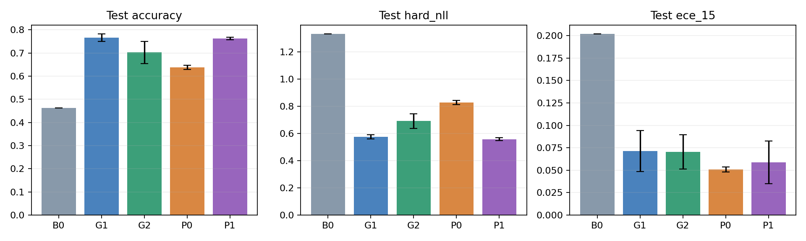
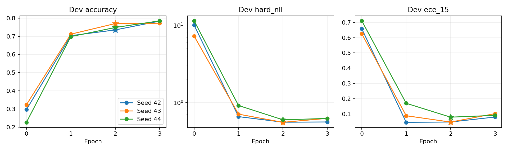
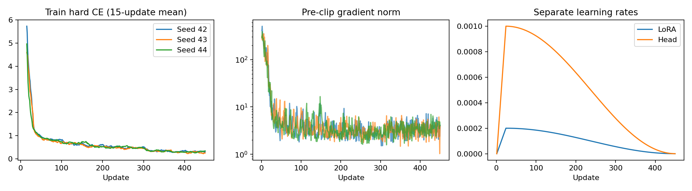
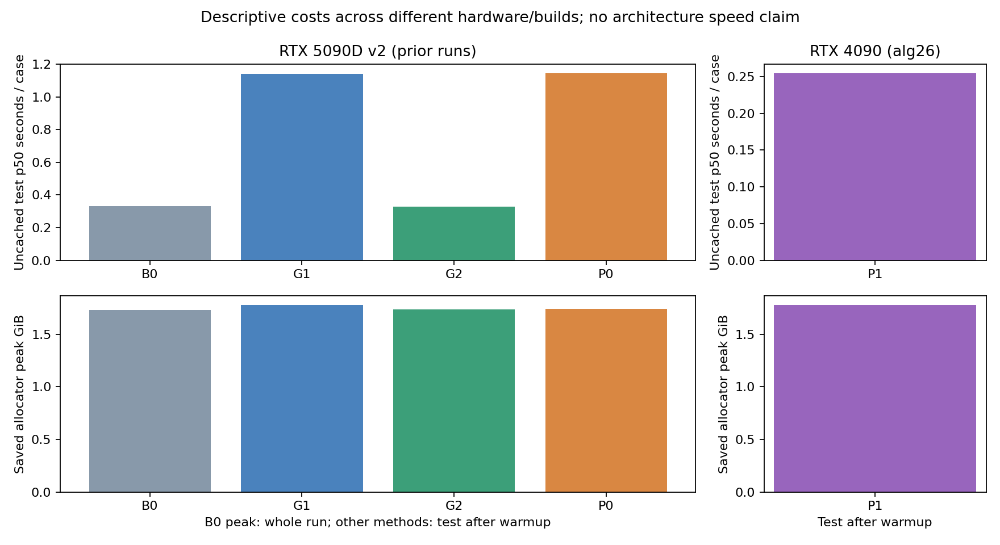

# P1：Pointer Head + Backbone LoRA

**状态：三个 seed 的450步训练、dev选模和官方test均已完成，离线结果复核与独立审查通过。**

P1 的 test Accuracy 为 **76.30% ± 0.58 pp**，相对 P0 提高 **12.50 个百分点**；与 G1 的 76.63% 接近。相对 G1 的平均差为 **-0.33 pp**，配对 case bootstrap 95% 区间为 **-1.05～+0.42 pp**，本轮没有观察到明确的准确率优势，也不能据此证明两种方法等价。

Accuracy 表示与数据集教师生成的 gold argmax 一致率，并非人工业务真值。± 为三个独立训练 seed 的样本标准差，全部概率未经温度校准。

P1 保持 P0 的 Pointer 结构，增加与 G1 相同范围的 Backbone LoRA。它与 P0 比较时研究“固定 Pointer 后，适配 Backbone 有多少收益”；与 G1 比较时研究“同类 LoRA 适配下，专用 Pointer 读出有何差异”。所有结论限定于本轮固定训练配方。

## 总体结果

| 指标 | B0 | G1 | G2 | P0 | P1（三 seed） |
| --- | --- | --- | --- | --- | --- |
| Accuracy | 46.30% | 76.63% ± 1.57 pp | 70.25% ± 4.74 pp | 63.80% ± 0.90 pp | **76.30% ± 0.58 pp** |
| Hard NLL | 1.3324 | 0.5766 | 0.6928 | 0.8284 | 0.5588 ± 0.0118 |
| Soft CE | 1.5062 | 1.3339 | 1.2844 | 1.2569 | 1.2732 ± 0.0877 |
| KL(gold ‖ prediction) | 0.7389 | 0.5665 | 0.5170 | 0.4896 | 0.5058 ± 0.0877 |
| Soft Brier | 0.3520 | 0.1607 | 0.1788 | 0.1688 | 0.1509 ± 0.0154 |
| Hard Brier | 0.7224 | 0.3300 | 0.4050 | 0.4796 | 0.3278 ± 0.0042 |
| ECE15 | 0.2017 | 0.0712 | 0.0704 | 0.0509 | 0.0589 ± 0.0238 |
| Score 期望 MAE | 0.7047 | 0.3181 | 0.3703 | 0.4284 | 0.3100 ± 0.0157 |

与 G1 相比，P1 的 Hard NLL、Soft CE、Brier、ECE 和 Score MAE 均值略低；这些是当前三 seed 的描述性结果，未对这些差值建立置信区间，不能概括为所有概率指标都有稳定优势。P0 的 Soft CE 和 ECE 均值仍更低，但 Accuracy 明显低于 P1。

| Accuracy 比较 | 平均差 | 配对 case bootstrap 95% 区间 |
| --- | --- | --- |
| P1 − B0 | +30.00 pp | +27.23～+32.98 pp |
| P1 − G1 | -0.33 pp | -1.05～+0.42 pp |
| P1 − G2 | +6.05 pp | +4.80～+7.30 pp |
| P1 − P0 | +12.50 pp | +10.70～+14.37 pp |

比较先取各模型 seed 正确性的均值，再按完整 case 配对重采样2,000次；没有平均概率构造集成模型。区间反映固定模型下测试案例的不确定性，三 seed 标准差反映本次重新训练的波动。



误差棒为三 seed 样本标准差，B0为单个固定模型。[SVG](figures/p1_comparison.svg)。

## 选模与学习过程

| Seed | 选中 epoch／step | Dev NLL | Test Accuracy | Test NLL | Test ECE15 |
| --- | --- | --- | --- | --- | --- |
| 42 | 2／300 | 0.5580 | 75.75% | 0.5541 | 0.0346 |
| 43 | 2／300 | 0.5559 | 76.90% | 0.5502 | 0.0598 |
| 44 | 2／300 | 0.5993 | 76.25% | 0.5723 | 0.0822 |

三个 seed 都完成3轮训练，但均按 dev Hard NLL 选择第2轮。第3轮没有用作正式 test 权重，也没有根据 test 改选。

| Seed | Dev NLL：epoch0→1→2→3 | Dev Accuracy：epoch2→3 | Dev Soft CE：epoch2→3 |
| --- | --- | --- | --- |
| 42 | 9.9883 → 0.6588 → **0.5580** → 0.5617 | 73.50% → 78.33% | 1.1593 → 1.6408 |
| 43 | 7.2130 → 0.7086 → **0.5559** → 0.6254 | 77.00% → 77.17% | 1.2322 → 1.7780 |
| 44 | 11.3664 → 0.9167 → **0.5993** → 0.6233 | 74.83% → 78.50% | 1.3519 → 1.6603 |

继续训练时，在线训练 CE 仍下降，dev Accuracy 也上升，但 dev NLL、Soft CE 和 ECE 均变差。三个seed的平均最大预测概率分别从78.07%／80.88%／82.79%升到86.11%／87.43%／87.30%，预测熵均下降，且平均置信度高于相应正确率，表现出概率锐化与过度自信。其具体成因仍需额外对照确认。按预设 NLL 选模比单看训练 loss 或 Accuracy 更符合本轮概率评估目标。

随机 Head 的 epoch0 在26逐 seed 实测，未复制 B0或P0预测。Head 初始权重按同一 seed 规则重新生成，并与 P0 初始哈希一致；Backbone 的硬件／运行栈不同，初始输出仍可能有数值差异。



星号表示按 dev NLL 选中的 epoch。[SVG](figures/p1_dev_curves.svg)。



左图为在线训练CE的15步滑动均值，中图为裁剪前梯度范数，右图为两组学习率。在线训练 loss 不等于固定模型在整个 train 上的 NLL。[SVG](figures/p1_training_curves.svg)。

## 分工作流与题型

| 工作流 | G1 Accuracy | P0 Accuracy | P1 Accuracy | P1 − P0 |
| --- | --- | --- | --- | --- |
| Agent 轨迹观测 | 70.80% | 51.40% | 70.80% ± 0.80 pp | +19.40 pp |
| 客服 | 80.13% | 72.00% | 80.20% ± 0.20 pp | +8.20 pp |
| 发票处理 | 80.67% | 66.27% | 79.27% ± 1.86 pp | +13.00 pp |
| 安全事件 | 74.93% | 65.53% | 74.93% ± 0.76 pp | +9.40 pp |

| 类型 | G1 Accuracy | P0 Accuracy | P1 Accuracy | P1 − P0 |
| --- | --- | --- | --- | --- |
| Choice | 73.39% | 64.22% | 73.44% ± 0.63 pp | +9.22 pp |
| Noul | 83.89% | 73.67% | 83.00% ± 1.53 pp | +9.33 pp |
| Score | 73.62% | 56.08% | 73.42% ± 1.89 pp | +17.33 pp |

固定 Pointer 下，加入 LoRA 后四个工作流及三种题型的均值都提高，Agent 轨迹观测和 Score 题的提升较大。与 G1 相比，各组接近，发票处理仍低约1.40 pp。这些分组是描述性比较，没有做逐组多重检验。

## 成本与 Q1／Q2 结论

| 项目 | G1 | P0 | P1 |
| --- | --- | --- | --- |
| 可训练参数 | 10,822,656 | 262,144 | 11,084,800 |
| 硬件 | RTX5090 | RTX5090 | RTX4090 |
| 实测每 case p50 | 1,140.28 ms | 1,144.31 ms | 254.49 ms |
| 评估峰值 allocated | 1.78 GiB | 1.74 GiB | 1.78 GiB |

**以上延迟不是同硬件对照，不能据此宣称 P1 或 Pointer 更快。** P1 p50为三个 run 各自 p50 的均值，样本标准差43.28 ms；各 seed 分别为279.14／279.82／204.52 ms，p95均值278.19 ms。同一卡上的三次测量也存在波动，本轮没有控制系统负载／时钟来隔离其原因。

P1正式训练峰值 allocated 为15.14～15.33 GiB。每 seed 纯更新累计476.18／467.39／478.00秒，合计约23分42秒；它不包含分词、检查点保存、dev／test和数据／来源验证。运行元数据记录的起止为北京时间2026-10-23 10:21:37至11:03:03，跨度约 **41分26秒**。P0缓存后的Head更新仅约5～6秒／seed，也不能直接当作P1完整训练的同口径成本。

全部 test 使用五道独立问题组成一个case，端到端同步计时包含分词、位置映射、传输、Backbone、未合并LoRA、FP32 Head、概率转换，排除加载、预热、指标和文件I/O。Head与LoRA联合训练的梯度和Adam状态为FP32；评估时优化器状态不在GPU。



图中不同显卡的数值只描述本次运行；B0显存为整轮评估峰值，其余为各test峰值。[SVG](figures/p1_costs.svg)。

- **Q1已有证据：** 保持Pointer结构及Head初始化规则，加入LoRA后，Accuracy从63.80%升至76.30%，当前配方有明确收益；P2仍需回答全量适配是否进一步有帮助。
- **Q2当前结论：** 同类LoRA适配下，Pointer尚未表现出明确的Accuracy优势。概率指标均值值得继续观察，但三seed、不同硬件／CUDA构建及两个参数组的优化配方限制了归因。
- **仍未验证：** 动态候选数量留出、候选顺序鲁棒性、未知候选语义泛化及Candidate Head。接口支持不能替代这些独立测试。

## 固定协议

| 项目 | 设置 |
| --- | --- |
| 起点 | 同一原始 Qwen3.5-0.8B；新建 Head 和 adapter，不继承任何已训练权重 |
| 输入 | 与 B0／G1／P0 相同聊天模板、候选说明、候选字母和五题独立上下文 |
| Pointer | 最后有效输入 token 为 query，候选文本末尾非空字符所在 token 为 key；两路无 bias 的 1024→128 共享投影 |
| LoRA | G1 同样的 186 个 Linear 目标，r16、alpha32、dropout0 |
| 可训练参数 | LoRA 10,822,656 + Head 262,144 = **11,084,800**，均为 FP32 |
| 冻结 | 全部 752,393,024 个原始 BF16 参数及原生 FP32 buffers，保留 embedding／原 LM Head 绑定 |
| 梯度 | 每步重算 Backbone；query／key 保留计算图；绕过 LM 词表投影 |
| 精度 | 训练 Backbone BF16 autocast；原生 eval 关闭 autocast；Head 始终执行 FP32 运算 |
| 数据 | 固定 revision 与 case 划分：train960／dev120／calibration120／test400 |
| 监督 | gold argmax 硬候选交叉熵；不训练 soft gold，calibration 不访问 |
| 初始化控制 | Head 按 P0 同 seed 规则独立随机生成，不加载 P0 权重；LoRA 初始化沿用 G1 顺序 |
| 优化 | AdamW：LoRA LR2e-4，Head LR1e-3；WD0.01，clip 全部可训练参数1.0，23步 warmup 后 cosine |
| 预算 | seed42／43／44，各3 epochs／450更新，有效 batch32 = micro8×累积4，已通过 train-only 实卡预检 |
| 选模 | 每 seed 实测随机 Head＋zero-LoRA 的 dev epoch0，再比较 epochs1～3，最小 Hard NLL、同分取更早步骤 |
| 测试 | 三个选择全部锁定后，每 seed 一次完整、未缓存的原生 test |

P1 仅缓存 tokens、候选位置和源身份，不能复用 P0 的冻结隐藏特征。LoRA 适配会改变 Backbone 表示，隐藏特征必须参与每次前向和反向。

## 26 服务器运行环境

- 主机：`alg26`（`192.168.0.26`），使用物理 GPU0 的 24GB RTX4090；GPU1 的4080有其他任务，本次不干预；20服务器不启动GPU工作。
- 专用 Conda prefix：`.runtime/conda/p1_26`，不改动已有环境和系统驱动。
- Python3.12.0、PyTorch2.9.0+cu126、Transformers5.14.1、PEFT0.19.1、Triton3.5.0、NumPy2.2.6。实际 BF16 CUDA 矩阵运算已经通过。
- 训练采用既有 project-local FLA DeltaNet chunk；normalization／convolution 与全部 dev／test 均保留原生路径。实际模型／梯度／显存预检已通过，GPU smoke 和流程审查完成后才启动正式任务。

旧 B0／G1／G2／P0 在5090上运行。准确率表可注明运行栈后并列比较，但4090上的P1延迟不能直接与旧延迟解释为 Head 的固有成本差；后续需同硬件测量才能回答该成本问题。

## 验证与恢复

基础模块8项、训练入口7项，共15项新CPU测试已在原环境和26实际Conda环境通过，独立规格及质量审查均通过。覆盖：P0输入与候选位置左 padding 重定位、query/key 到 LoRA 的梯度、两路 Head 梯度与 FP32 边界、原参数/buffers不更新、联合 Head＋adapter 保存和精确下一步恢复、混合步骤或修改 LoRA 配置拒绝，以及随机epoch0、锁定选模、原生完整计时和部分heldout拒绝。

26 的 train-only 实卡预检已通过：zero-LoRA 原生 Pointer 与同机 P0 路径逐位一致，原 LM Head 投影调用0次，最长训练输入666 tokens；连续3次完整32题更新（micro8×累积4）后，Head、LoRA B和后续LoRA A均发生更新，全部原参数和 buffers 哈希不变。最坏输入的训练峰值 allocated 约 **15.09 GiB**，reserved 约16.26 GiB。

native/FLA 的采样梯度比较：LoRA cosine **0.9895**、relative L2 **0.1465**；Head cosine **0.9989**、relative L2 **0.0470**，均通过事先规定的0.95／0.35容差。两条训练内核路径是数值近似，不是逐位相同；全部正式评估仍使用原生后端。

GPU smoke已完成：[smoke_train_20261023_101933_849750](../outputs/02_supervised/p1/smoke_train_20261023_101933_849750/)。两次更新后保存联合检查点，重载后的原生输出逐位一致，再恢复optimizer／scheduler／RNG完成第三次更新；原始参数及buffers不变，没有dev/test目录。smoke只证明流程可用，不作为正式效果证据。

正式启动前已对比26当前runtime与预检指纹逐项一致，并核对全部34份训练源码当前文件／smoke归档哈希、固定配置和预检来源。

每个检查点必须同时包含同一步的 adapter、Head、优化器、scheduler、全部 RNG 和进度，完整校验后才更新 latest。恢复校验配置、代码、模型、数据、runtime、内核和本机预检；部分 heldout 结果拒绝隐式重跑。

## 记录

- [设计](../docs/superpowers/specs/2026-10-23-p1-design.md)
- [执行计划](../docs/superpowers/plans/2026-10-23-p1.md)
- [预检入口](../experiments/02_supervised/profile_p1.py)
- [实卡预检记录](../outputs/02_supervised/p1/preflight_train.json)
- [正式配置](../experiments/02_supervised/configs/p1.yaml)
- [运行入口](../experiments/02_supervised/run_p1.py)
- [正式启动记录](../outputs/02_supervised/p1/launches/20261023_102130.json)
- [启动日志](../outputs/02_supervised/p1/launches/20261023_102130.log)
- [启动完整性复核](../outputs/02_supervised/p1/train_20261023_102132_592199/startup_verification.json)：保留启动时的历史记录；最终结果以完成后的离线复核为准。

正式 run：[train_20261023_102132_592199](../outputs/02_supervised/p1/train_20261023_102132_592199/)，2026-10-23 **10:21:30（北京时间）**在26服务器启动，**11:03:03完成**。[状态](../outputs/02_supervised/p1/train_20261023_102132_592199/metadata.json)为 `complete`，[原始汇总](../outputs/02_supervised/p1/train_20261023_102132_592199/summary.json)已含三个seed的test及四组配对比较，[训练日志](../outputs/02_supervised/p1/train_20261023_102132_592199/run.log)保留完整过程。

每个seed完成450步并保存初始、各epoch的联合检查点；正式选中的都是step300。LoRA与Head必须使用同一步联合状态，并配合原始冻结Backbone加载；不能只取其中一个文件替代完整模型。

运行与恢复命令见[阶段2说明](../experiments/02_supervised/README.md)。P2／C1 和阶段3～4尚未启动。

## 最终复核与复用

已离线复核 **13,200条P1预测**（三个seed，各4×600条dev和2,000条test），另核对B0／G1／G2／P0的 **20,000条参考test预测**。源身份、候选、gold／hard target、原始logits、有效mask、概率、输入长度和逐case计时均逐项对应；总体／分组／bootstrap、三seed均值／样本标准差及四组配对比较与原summary一致。保存概率与logits重建概率的最大绝对差为 **1.82e-07**。

全部12份epoch联合检查点，包括Head、adapter、config和trainer文件哈希、FP32参数与Adam状态、双学习率、scheduler／RNG／进度及同一步联合代际，均校验通过。三个seed的450步连续训练、P0匹配的新Head初始化、冻结原参数及FP32 buffers前后状态、34份源码当前文件／归档、原始模型／数据／划分／运行环境／预检／FLA来源均通过核对。文件mtime支持先完成全部选模再开始test；它是文件系统证据，不是外部防篡改时间戳。

本次只读取已保存产物，没有模型前向、额外heldout推理或训练；原预测、metrics、summary、配置、训练源码及检查点保持不变。新增9项离线验证测试已通过，独立规格和质量审查均通过。

- [分组、dev曲线、置信度／熵、成本和配对分析](../outputs/02_supervised/p1/train_20261023_102132_592199/analysis.json)
- [完整复核记录与哈希](../outputs/02_supervised/p1/train_20261023_102132_592199/verification.json)
- [所选联合模型：原始Backbone＋同一步Head／adapter](../outputs/02_supervised/p1/train_20261023_102132_592199/selected_joint_models.json)
- [独立最终审查记录](../outputs/02_supervised/p1/train_20261023_102132_592199/final_review.json)
- [离线复核工具](../experiments/02_supervised/finish_p1.py)及[测试](../tests/test_p1_analysis.py)

复用所选模型时，使用原运行配置和 `run_p1.py` 的 `create_pair` 创建原始冻结Backbone、LoRA及Pointer Head，再用 `load_joint_weights` 加载注册表中的step300联合检查点；使用同一提示、位置映射、原生后端和temperature1。注册表不表示完整合并模型，Head和adapter需来自同一代。

可在26的原Conda环境用以下命令重复CPU离线复核和图表生成。命令保留CUDA可见性以核对构建指纹，但不执行模型推理，也不自动改写人工报告或README：

```bash
P1_PYTHON="$PWD/.runtime/conda/p1_26/bin/python3.12"
CUDA_DEVICE_ORDER=PCI_BUS_ID CUDA_VISIBLE_DEVICES=0 OMP_NUM_THREADS=1 MKL_NUM_THREADS=1 \
  $P1_PYTHON experiments/02_supervised/finish_p1.py \
  --run outputs/02_supervised/p1/train_20261023_102132_592199
```

已经完成的run无需 `--resume`；后续P2、C1或新的训练配方分别建立独立实验。
